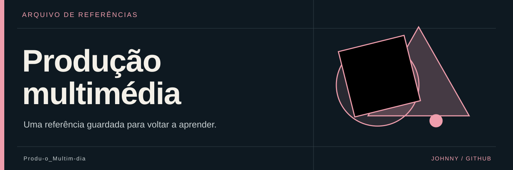

  

# 🎬 Produção multimédia

**Uma referência guardada para voltar a aprender.**

Este repositório conserva o ficheiro [Tutorial de completar bordas](Tutorial%20de%20completar%20bordas), que contém uma ligação externa para o TikTok. Não inclui o vídeo, um projeto de edição ou um tutorial incorporado.

## 🔖 Consultar

Abre o ficheiro para consultar o endereço original. A disponibilidade e o conteúdo da página externa dependem do respetivo autor e serviço; não foram verificados nesta revisão.

## 🎨 Sobre a apresentação

A capa é uma ilustração editorial. A referência continua identificada pelo nome original, sem atribuir a autoria do tutorial ao proprietário deste repositório.
